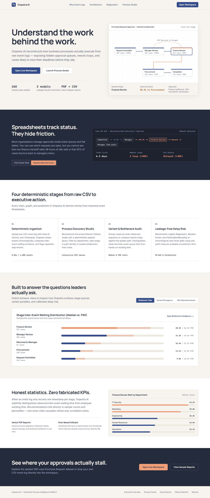
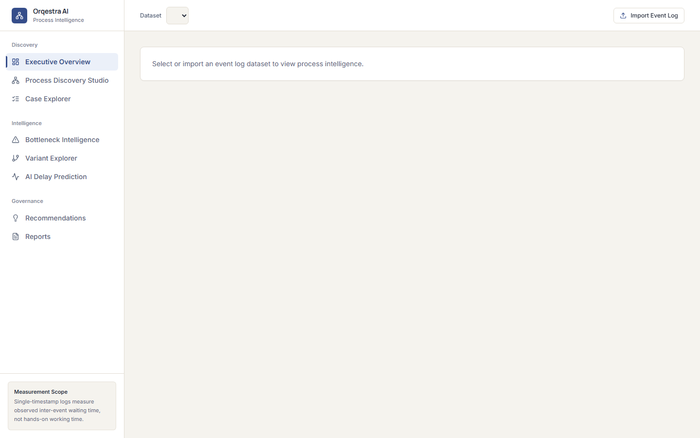
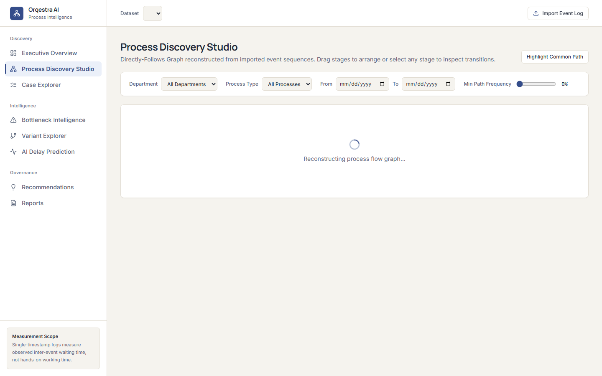
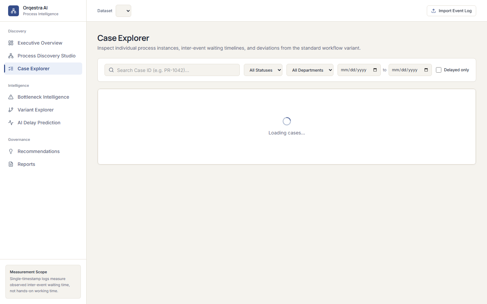
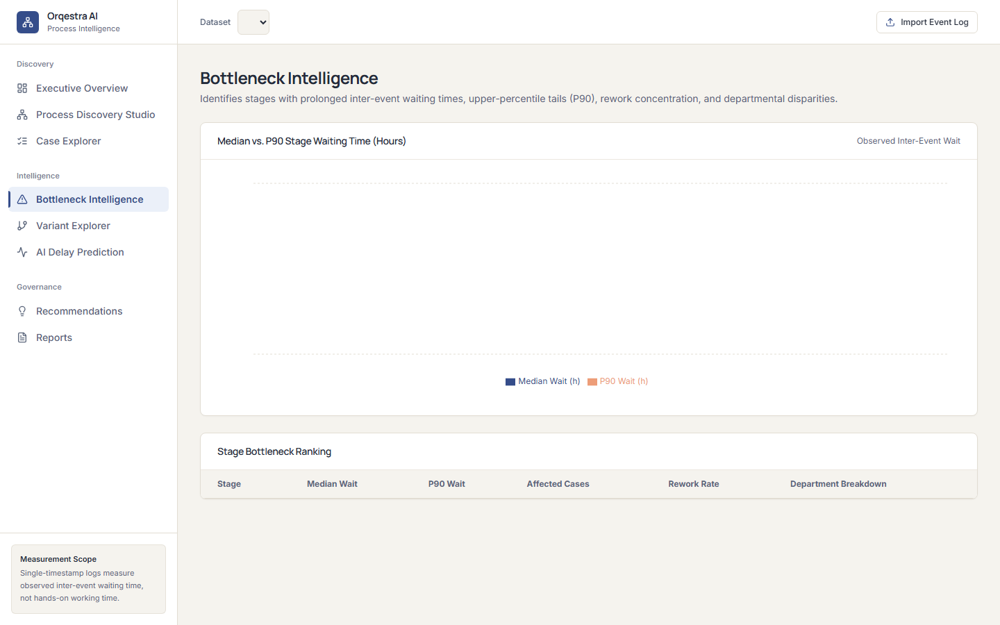
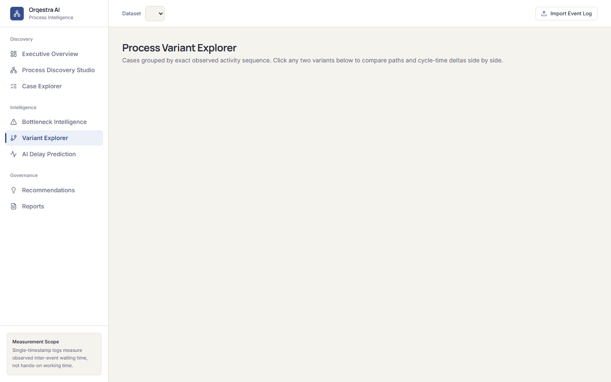
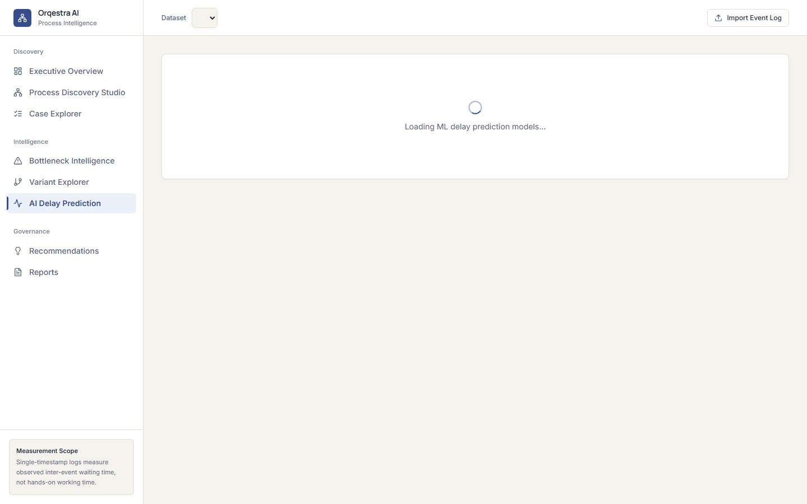
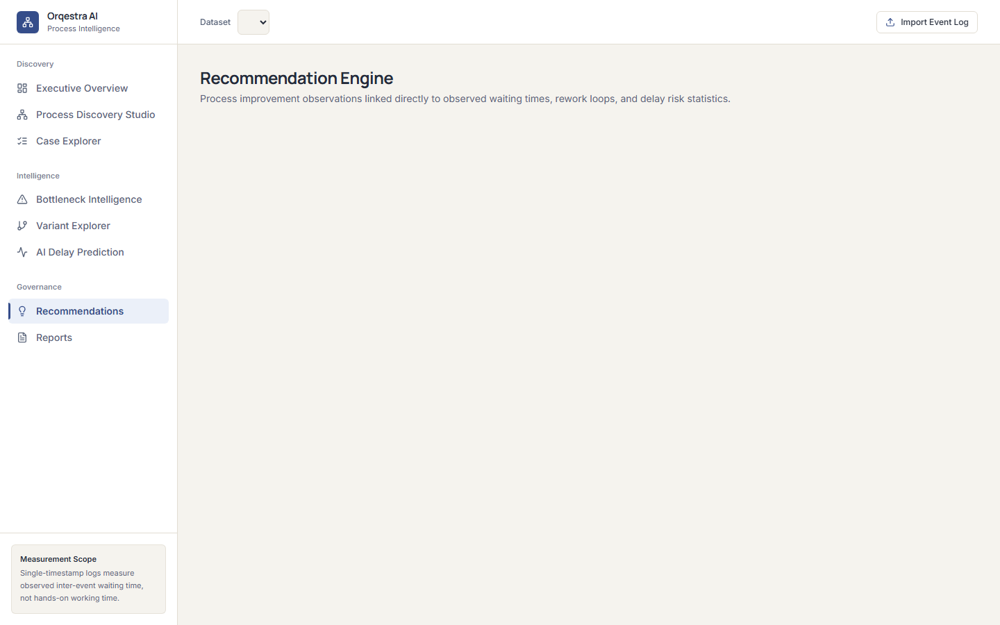
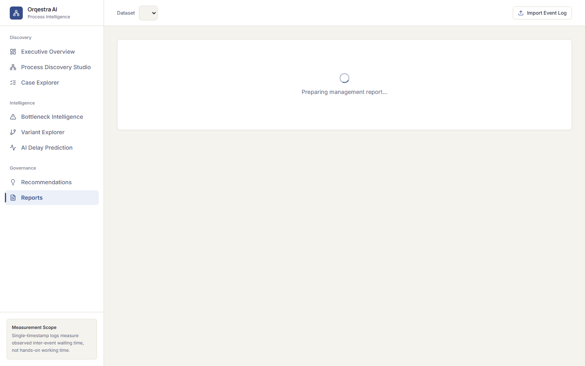

# Orqestra AI — Enterprise Process Intelligence Platform

Orqestra AI discovers how business processes actually execute from raw event logs — reconstructing execution paths, measuring inter-event waiting bottlenecks, comparing workflow variants, predicting deadline risk without future-event leakage, and exporting executive PDF/CSV reports.

---

## Tech Stack

- **Frontend**: Next.js App Router, TypeScript (`strict`, `noImplicitAny`, `noUncheckedIndexedAccess`), Tailwind CSS v4, React Flow (`@xyflow/react`), Recharts, Motion
- **Backend**: Python FastAPI, pandas, SQLAlchemy, PostgreSQL (`pg8000`) / SQLite
- **Machine Learning**: scikit-learn (`LogisticRegression`, `RandomForestClassifier`, `HistGradientBoostingClassifier`)
- **Reporting**: `fpdf2` (vector process diagrams + multi-section PDF) & Python `csv`

---

## Application Pages & Features

### 1. Landing Page (`/`)



- **Interactive SVG Process Specimen**: Click any stage in the Purchase Request Approval diagram (`Request Submitted`, `Manager Review`, `Finance Review`, `Procurement`, `Completed`) to inspect live queue wait times, case reach, and rework diagnostics.
- **Flat Tracker vs. Orqestra Reconstruction Toggle**: Contrast raw flat CSV rows against reconstructed execution timelines with inter-event delays and SLA status.
- **4-Stage Analytical Pipeline Index**: Architectural breakdown of ingestion, process discovery, variant/bottleneck auditing, and leakage-free ML risk.
- **Interactive Diagnostic Workbench**: 3-tab preview covering Bottleneck Tails (Median vs. P90), Variant Divergence (Standard Path vs. Rework Loop), and ML Delay Benchmarks.
- **Departmental Variance & Measurement Integrity**: Highlights observed inter-event waiting times by department alongside explicit single-timestamp measurement scope.

---

### 2. Executive Overview (`/overview`)



- **Architectural Telemetry Strip**: Real-time KPIs derived strictly from imported events — Total Cases, Completed/Rejected/Cancelled counts, Median & P90 Cycle Time, Delayed Cases (count & rate), and Rework Frequency.
- **Process Volume & Delay Trend**: Weekly cohort area chart (`Recharts`) tracking started, completed, and delayed cases over time.
- **Case Outcome Distribution Gauge**: SVG arc gauge summarizing Completed, Open, and Closed (Rejected/Cancelled) case shares.
- **Primary Bottleneck Spotlight & Activity Coverage**: Surfaces the single slowest stage by median inter-event wait and displays case-reach progress bars across every discovered activity.

---

### 3. Process Discovery Studio (`/studio`)



- **Interactive Directly-Follows Graph (`@xyflow/react`)**: Deterministic longest-path layered layout reconstructed from imported event sequences.
- **Node Drag-and-Drop & Reset Layout**: Drag any activity node to customize arrangement while preserving positions across highlights, or click **Reset Layout** to snap back to the deterministic coordinates.
- **Stage Telemetry Cards**: Each node displays case count, case share %, median wait to the next activity, rework loop count, and Apricot bottleneck indicators.
- **Contextual Activity Inspector**: Clicking any node opens the right-hand inspector detailing incoming and outgoing transitions, transition counts, case percentages, and P90 wait times.
- **Filtering & Density Controls**: Filter live by **Department**, **Process Type**, **Date Range (`From` / `To`)**, **Min Path Frequency** slider (for simplifying dense graphs), and **Highlight Common Path** toggle.

---

### 4. Case Explorer (`/cases`)



- **Paginated Case Table**: Browse all imported process instances with inline step counts and rework loop badges.
- **Multi-Criteria Filtering**: Search by **Case ID** (e.g., `PR-1042`), filter by **Completion Status** (`completed`, `open`, `rejected`, `cancelled`), **Department**, **Date Range (`From` / `To`)**, and **Delayed only** toggle.
- **Event Timeline Inspector**: Click any case row to inspect its chronological event timeline with proportional inter-event wait bars, assigned roles, event outcomes, and explicit deviation comparison against the Standard Path.

---

### 5. Bottleneck Intelligence (`/bottlenecks`)



- **Median vs. P90 Waiting Chart**: Visual comparison of typical queue times against upper-percentile tail delays across all workflow stages.
- **Stage Bottleneck Ranking Table**: Ranks stages by bottleneck score, showing median wait, P90 wait, affected case count, rework rate, and per-department median wait breakdowns.
- **Measurement Discipline**: Explicitly distinguishes observed inter-event waiting time (between consecutive logged timestamps) from hands-on employee working time.

---

### 6. Process Variant Explorer (`/variants`)



- **Sequence Grouping**: Automatically groups all cases by their exact observed sequence of activities (`V-4A81C2`, `V-9F4E12`, etc.).
- **Side-by-Side Visual Comparison**: Click any two variants to compare their activity sequences, cycle-time delta vs. the Standard Path, delay rates, average rework, and completion outcomes.
- **Proportional Volume Bars**: Instant visual indicator of variant concentration and rework-heavy paths.

---

### 7. AI Delay Prediction (`/predictions`)



- **Leakage-Free 3-Model Benchmark**: Trains and evaluates **Logistic Regression**, **Random Forest**, and **HistGradientBoosting** using a chronological 75/25 case-level split on prefix features observed strictly prior to completion (Precision, Recall, F1-Score, PR-AUC, ROC-AUC, Brier Score).
- **Probability Calibration & Predictive Signals**: Calibration curve comparing predicted probability against observed delay rate, plus top feature importances.
- **In-Progress Risk Queue**: Scores open cases with delay probability, risk tier (`high`, `medium`, `low`), and human-readable contributing factors, with a deterministic rule-based fallback for small datasets.

---

### 8. Recommendation Engine (`/recommendations`)



- **Evidence-Linked Suggestions**: Synthesizes prioritized observations for top bottleneck stages, departmental queue disparities, rework cycle-time penalties, variant standardization, and high-risk open cases.
- **Statistical Provenance & Causation Caveats**: Every recommendation displays the exact supporting metrics and an explicit caveat distinguishing observational correlation from causal proof.

---

### 9. Management Reports (`/reports`)



- **One-Click PDF Export (`fpdf2`)**: Generates a multi-section executive PDF containing Process Overview KPIs, an **embedded vector Directly-Follows Graph diagram**, Bottleneck Rankings, Top Variants, ML Evaluation & Open Risk, Recommendations, and Analytical Limitations.
- **CSV Summary Export**: Structured tabular export of all computed metrics, bottlenecks, variants, predictions, and recommendations.
- **Report History**: Logs every generated export with format, file size, timestamp, and instant re-download.

---

## Quick Start (Local Development)

### 1. Backend (FastAPI)

```bash
cd backend
python -m venv .venv
# Windows: .venv\Scripts\activate  |  macOS/Linux: source .venv/bin/activate
pip install -r requirements.txt
uvicorn app.main:app --reload --port 8000
```

On first boot, the backend initializes the database, seeds `data/sample_purchase_requests.csv` (260 synthetic purchase-request cases), computes process-mining metrics, and trains the 3 ML delay-prediction models.

### 2. Frontend (Next.js)

```bash
cd frontend
npm install
npm run dev
```

Open [http://localhost:3000](http://localhost:3000).

### 3. Docker Compose (PostgreSQL + Backend + Frontend)

```bash
docker compose up --build
```

---

## Documentation

- [Architecture Diagram](docs/ARCHITECTURE.md)
- [Database Schema & ERD](docs/DATABASE_SCHEMA.md)
- [Functional & Non-Functional Requirements](docs/REQUIREMENTS.md)
- [Testing Report](docs/TESTING_REPORT.md)
- [Demonstration Guide](docs/DEMO_GUIDE.md)
