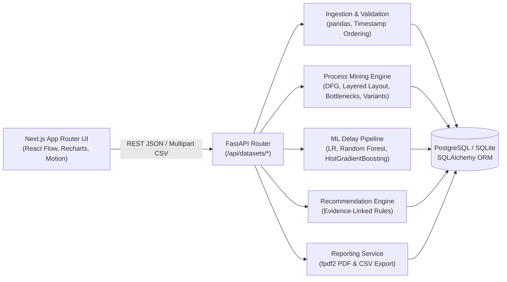

# Orqestra AI — System Architecture

## Overview

Orqestra AI separates event-log ingestion, deterministic process-mining computation, leakage-free machine learning inference, and interactive visualization into clean architectural layers.

## Key Architectural Decisions

1. **Deterministic Process Graph Layout**: Graph node layers and `(x, y)` coordinates are computed deterministically on the backend using topological longest-path ranking with cycle breaking, ensuring reproducible diagrams across reloads.
2. **Leakage-Free ML Pipeline**: Closed cases are split chronologically (`75%` earliest for training, `25%` latest for testing) at the case level. Feature extraction uses only event prefixes observed prior to completion, and historical stage median waits are computed strictly on the training split.
3. **Single-Timestamp Measurement Honesty**: When event logs contain one timestamp per activity, Orqestra AI explicitly reports *observed inter-event waiting time* rather than claiming to measure hands-on employee working time.
4. **Database Portability**: SQLAlchemy ORM models support PostgreSQL (`pg8000` driver in Docker/production) and SQLite for zero-dependency local evaluation and automated testing.
